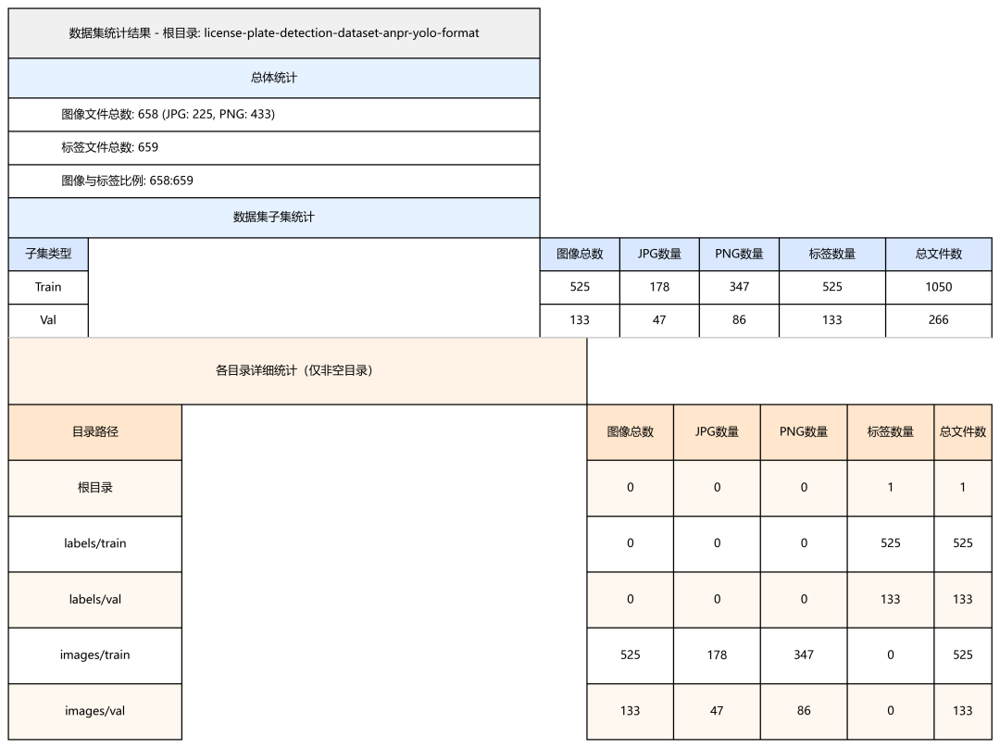
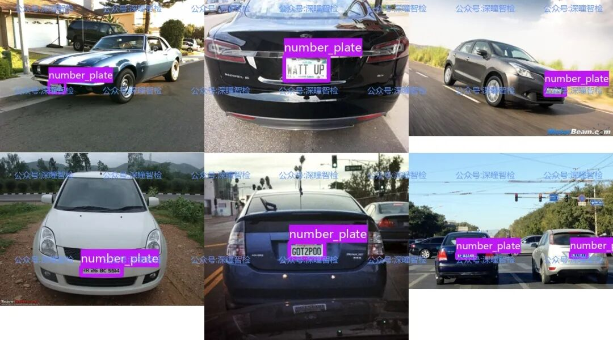
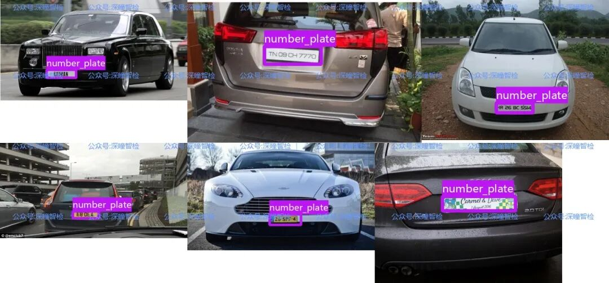
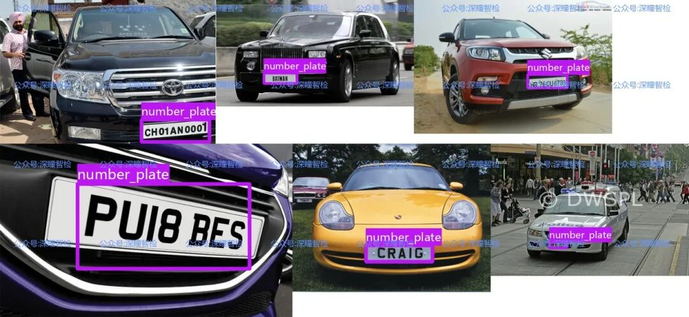
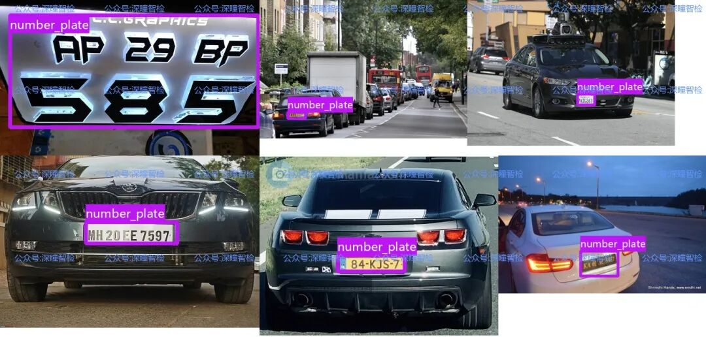

# Target Detection Dataset Issue 004 - License Plate Detection Dataset Based on YOLO Annotation Format

1. Background: Why is a specialized license plate detection dataset needed?

With the rapid development in intelligent transportation, parking lot automation management, and road monitoring, license plate recognition (ANPR) technology has become one of the core applications for computer vision. A high-quality, standardized dataset is essential to train precise license plate detection models.

In traditional license plate detection tasks, developers often face two major challenges: firstly, the format of the dataset is not uniform, requiring a significant amount of time to convert (e.g., from XML format to the TXT format required by YOLO); secondly, the quality of data varies greatly, with issues such as duplicate labeling and inaccurate bounding boxes directly impacting the model training results.

To address these issues, a license plate detection dataset has emerged. This dataset integrates two popular license plate detection data sources and is uniformly converted into YOLOv8/v11 compatible formats. It has been rigorously validated before release, allowing developers to directly use it for model training without the need for preprocessing, significantly enhancing development efficiency.

2. Data Details: Comprehensive Analysis of the Dataset Features

##### (1) Basic Scale and Composition

-

• **Total Sample Size**: Includes 658 images, corresponding to 658 annotation files, covering different scene, lighting and vehicle type license plate samples.

-

• **Data Partitioning**: The training set (train) and validation set (val) have been automatically split into 8:2 ratios, without the need for manual partitioning.

-

• **Labeling Format**: All labels are in the YOLO-specific `.txt` format, each file contains bounding box coordinates and category information for license plates, directly compatible with YOLOv8/v11 models.

##### (2) Structural Design

The dataset is organized in a clear folder structure, facilitating direct model invocation:

```
YOLO_dataset/
├── images/       # Image file
├── train/
└── val/ ## Validation set images
├── labels/ # Annotation file
├── train/ # Training set annotations
└── val/ ## Validation set annotations
```

##### (3) Core Advantages

-

• **Format Compatibility**: Converts from XML format to YOLOv8/v11 format, eliminating the need for complex format conversion steps.

-

• **Quality Assurance**: After rigorous verification, ensure category consistency (only "license plate" category) and label completeness, with no duplicate images or invalid bounding boxes.











#### 3. Application scenarios: What can this dataset do for you?

##### (1) Intelligent Transportation System

Through training the license plate detection model, Real-time identification of license plates on vehicles traveling on the road. Applied to red light violations. Speed monitoring In scenarios such as illegal parking enforcement and evidence collection. Improve traffic management efficiency.

##### (2) Parking Lot Automation Management

Install a license plate detection system at the entrance / exit of the parking lot. Can automatically recognize the license plate of the vehicle entering and record the time. The parking fee is automatically settled upon exiting the premises. Implement unmanned management. Reduce labor costs.

##### (3) Security Monitoring

In the community, In enclosed areas such as parks, The vehicle detection can recognize the foreign vehicles through license plate. In conjunction with the blacklist system's automatic early warning. Enhance regional security.

##### (4) Model Research and Learning

For computer vision learners or researchers, this high-quality and standardized dataset is an ideal material for beginners in object detection (especially the YOLO series models), which can be used for model performance testing and algorithm optimization research work.


## Payment

Here is a pay link on Stripe ( https://buy.stripe.com/3cs8yP7sY87d0vu9AB ). Please contact me lonlonago@foxmail.com after funding $89, and I will send you a complete data files , thank you!


